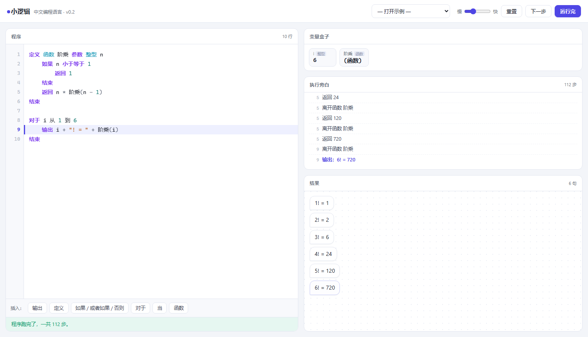

# 小逻辑 KidLang

**一门用中文写的编程语言。语法骨架照着 C 和 Python 来，关键字是中文的。**


*KidLang — a programming language whose keywords are Chinese, built to make every step of execution visible.*



---

## 这是什么

你可以用它定义变量、写分支和循环、定义函数、操作数组和指针、读写文件——完整的一门语言，不是玩具。

它和一般编程环境最大的区别是：**程序不是「跑一下就出结果」，而是「一步一步演给你看」**。每执行一句，你能看到当前走到第几行、哪个变量的值变了、程序的每一步推理在做什么。

三个刻意的设计：

**不依赖缩进。** 语句边界由关键字决定。缩进乱了、整段挤成一行、Tab 和空格混用，都照跑。Python 的缩进敏感是初学者第一大崩溃源，而它在教学上没有任何收益——缩进表达的结构，`结束` 已经表达了。

**没有 `=` 和 `==`。** 赋值说「把 x 改成」，比较说「等于」。C 语言里最经典的混淆，在这门语言里从语法层面就不存在。

**每个动作都留下痕迹。** 解释器每执行一步就产出一份快照（行号 / 中文旁白 / 变量现场 / 输出），界面就是这份快照的投影。所以「程序为什么是这个结果」是可以回放的，不是靠脑补。

---

## 快速开始

### 方式一：在线玩

直接打开：

**https://champawang.github.io/kidlang/**

手机电脑都能用，不用装任何东西。

### 方式二：下载单文件

下载 `index.html` 和 `interpreter.js` 两个文件放在一起，双击 `index.html`。

不需要安装任何东西，不需要联网。

### 方式三：从源码跑

```bash
git clone https://github.com/<你的用户名>/kidlang.git
cd kidlang
node test.js          # 跑测试，69 条
# 然后用浏览器打开 index.html
```

### 方式四：打包成桌面 exe（可选）

```bash
pip install pywebview pyinstaller
python build/build-exe.py
```

会生成一个 17 MB 的单文件 exe，用 WebView2 内核，是真正的原生窗口（无地址栏）。

---

## 界面

```
┌──────────────────────────────────────────────────┐
│ ● 小逻辑   示例▾  速度 重置 下一步 [运行完]        │ 功能栏
├───────────────────────────┬──────────────────────┤
│ 1  定义 整型 年龄 是 11    │ 变量盒子             │
│ 2  如果 年龄 大于 10       │  年龄  整型   11     │
│ 3      输出 "长大了"       ├──────────────────────┤
│ 4  结束                    │ 执行旁白             │
│                            │  3  如果 [...] 成立  │
│  语法高亮 + 当前行高亮      │  4  输出：长大了     │
│                            ├──────────────────────┤
│                            │ 结果                 │
│                            │  > 长大了            │
└───────────────────────────┴──────────────────────┘
```

- **变量盒子**：每个变量当前的值和类型。值变动的卡片会放大闪一下
- **执行旁白**：每一步的中文解释——走了哪个分支、循环到第几圈、哪个变量从几变成几
- **结果**：程序输出的内容，一句一个气泡

### 快捷键

| 键 | 作用 |
|---|---|
| `F9` | 运行完 |
| `F8` | 下一步 |
| `F5` | 重置 |
| `F10` | 猜结果（先写下预测，再看答案） |
| `Ctrl + Enter` | 同 F9 |
| `Tab` | 插入 4 个空格 |

---

## 语法速览

```
定义 整型 年龄 是 11
定义 名字 是 "小明"                 # 类型可以省略，自动推断
把 年龄 改成 12
给 年龄 加上 1

如果 分数 大于等于 90
    输出 "优秀"
或者如果 分数 大于等于 60
    输出 "及格"
否则
    输出 "要加油"
结束
```

三种循环，按「你知不知道要跑几次」来选：

```
对于 i 从 1 到 10                  # 计数循环
当 n 小于等于 3                    # 条件循环
做 … 结束当 条件                   # 先跑一遍再判断
```

函数支持递归与词法作用域：

```
定义 函数 阶乘 参数 整型 n
    如果 n 小于等于 1
        返回 1
    结束
    返回 n * 阶乘(n - 1)
结束

输出 阶乘(5)                       # 120
```

八种类型：`整型` `浮点型` `布尔型` `字符型` `字符串` `数组` `指针` `文件`

```
定义 数组 分数 是 [92, 78, 85]
定义 指针 p 是 &分数
输出 *p                            # 顺着指针读到 90
把 *p 改成 100                     # 通过指针改，分数变成 100

定义 文件 f 是 打开文件 "a.txt" 为 写
写 f "一行内容"
关闭 f
```

四则运算语义同 Python：`+ - * / // % **`（`//` 整除，`**` 乘方）

完整语法见 **[docs/SPEC.md](docs/SPEC.md)**，或下载 [使用手册 PDF](docs/handbook.pdf)。

---

## 几个细节

**软关键字。** `是 / 时 / 次 / 从 / 到 / 步长 / 为` 按位置识别，所以「时间」「为什么」「次数」「从来不是」都能当变量名：

```
定义 时间 是 12
定义 为什么 是 "因为"
```

**逻辑运算只接受布尔值。** `如果 1 与 真` 会直接报错，必须写清楚比较。C 里「非零即真」是初学者出错的重灾区，这里堵掉了。

**do-while 用 `结束当` 收尾。** `做` 的循环体里可能再套一个 `当` 循环，单独一个 `当` 分不清是内层循环的开头还是 do-while 的结尾。

**全角标点自动识别。** `（2 ＋ 3） × 2` 得 10，字符串内部的标点原样保留。

**文件是虚拟的。** 程序跑在内存里，不碰真实磁盘，界面上能看到文件内容。怎么折腾都安全。

**报错是说人话的。**

```
定义 整型 年龄 是 11.5
→ 「年龄」是整型，不能放小数 11.5
   想放小数请用「定义 浮点型」
```

---

## 项目结构

```
.
├── index.html            界面（单文件，无构建步骤）
├── interpreter.js        解释器：词法 → 语法 → 生成器执行
├── test.js               69 条测试用例
├── examples/             九个示例程序（.kid）
├── docs/
│   ├── SPEC.md           语言规范
│   ├── handbook.pdf      11 页使用手册
│   └── img/
├── assets/               图标与海报
└── build/
    ├── build-exe.py      打包成桌面 exe
    └── requirements.txt
```

解释器约 1500 行，零依赖，浏览器和 Node 双端可用。

`interpreter.js` 的核心是一个 **generator 解释器**：每执行一个语义动作就 `yield` 一份快照后挂起。单步执行、行高亮、变量监视、旁白日志，全部是这份快照的不同投影。

---

## 开发

```bash
node test.js        # 69 条测试
```

测试覆盖：类型检查、Python 语义的取余与整除、三种循环、递归、二维数组、指针读写、文件追加、全角标点、挤成一行、不缩进等「孩子会怎么乱写」的场景。

改界面不需要构建，直接编辑 `index.html`。

---

## 已知限制

- 没有结构体 / 类
- 字符串只有 `长度`，没有子串、查找、替换
- 没有 `switch`（用 `或者如果` 链代替）
- 文件系统是虚拟的，不落盘
- 浮点用 double，`0.1 + 0.2` 显示为 `0.3`（内部仍是 double 精度）

---

## 协议

[MIT](LICENSE) © 2026 ChampaWang

随便用、随便改、随便发，保留版权声明就行。
